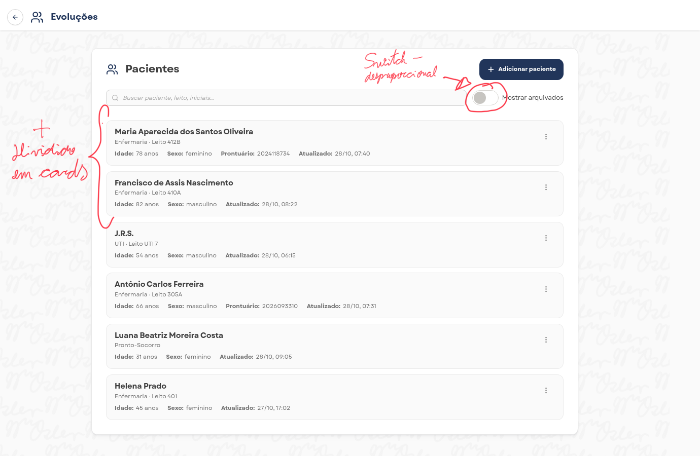
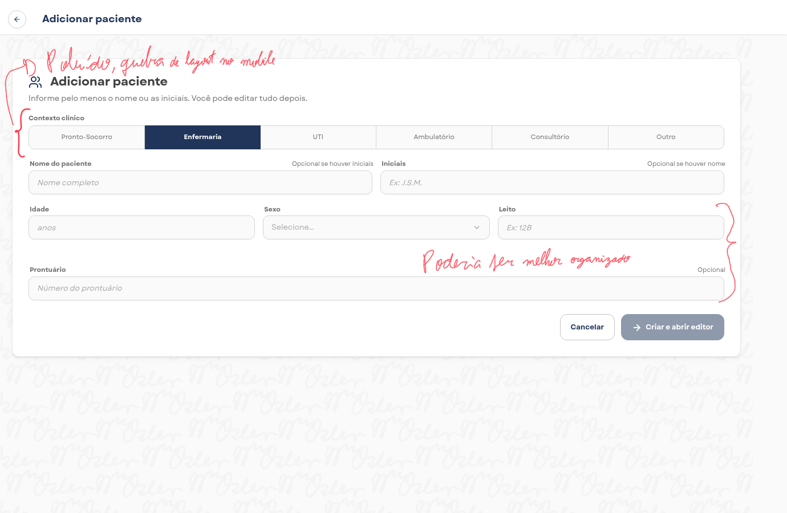
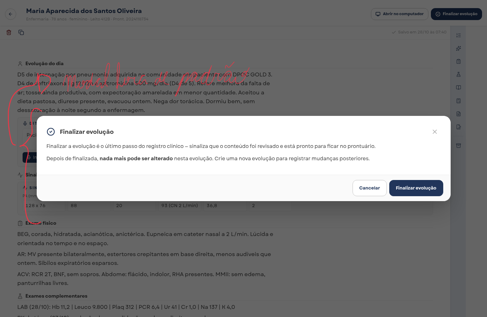
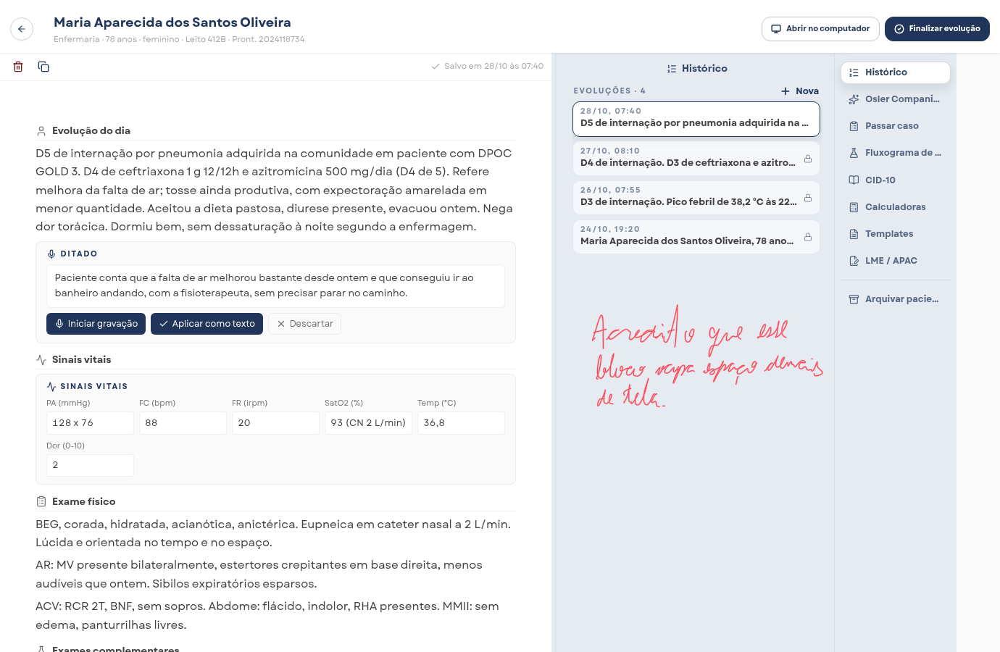

# Proposta
Minha proposta se divide em duas fases/opções, sendo uma mais simples e outra mais complexa.

## Objetivo da tela

Prontuário do paciente com suas evoluções.

## Pontos em comum das duas propostas

- Tela de listagem simples demais, somente com informações escritas, pode causar monotonia e não diz nada sobre o estado do paciente logo de cara(card sem resumos).
- Nas duas propostas mantive a listagem divido em cards, acredito ser interessante e bem compartimentado.
- Mantive a estrutura do formulário por estar que estar enxuta pelo que o produto demonstra, como modificações pontuais em relação ao tipo de input utilizado no Contexto clínico, seccionalização dos dados que são solicitados e sua disposição no form.
- Tanto os dados retornados pelo backend, quanto o próprio backend podem precisar de ajustes ou novas demandas para adequar melhor as mudanças propostas, mas que precisam ser analisadas pelo time como um todo, bem como o tempo disponível, backlog controlado e momento do próprio produto.

## Proposta simples

- Adicionei um avatar em cada card que pode ter a foto ou somente um ícone de usuário, de todo modo o avatar mostra o estado de saúde geral do paciente que é calculado/processado pelo backend baseado nas próprias evoluções adicionadas no prontuário.
- Ajustei o tamanho do switch a fim de tornar mais harmônico essa parte do sistema.
- Na tela de adicionar paciente adicionei a um collapse em cada seção para que os dados fiquem mais organizados visualmente, melhorando legibilidade e ainda assim possibilitando a abertura de todo o conteúdo.
- Também precisei adicionar um input de imagem do paciente.
- No retorno do backend adicionei os seguintes parâmetros: health_status, que diz respeito ao estado de saúde do paciente e isto precisaria ter seu cálculo implementado no back como mencionei mais acima. E o photo_avatar, referente a imagem do paciente inserido no form.

### O que muda no backend

| Campo | Descrição |
|-------|-----------|
| `health_status` | Estado de saúde geral do paciente. O cálculo precisa ser implementado no backend, a partir das evoluções. |
| `photo_avatar` | Imagem do paciente enviada pelo formulário. |

## Proposta complexa

Além do que foi descrito na proposta simples:

- A listagem perdeu aquele container que engloba todos pacientes
- O switch anterior foi modernizado.
- Foi adicionado uma barra de progresso com o intuito de acompanhar o andamento das evoluções e deixa mais visual para o usuário
- A data de hoje adicionado no topo também trás uma sensação de localização no tempo, sem recorrer a recursos externos como calendários externos, simples e direto.
- Os cards aparecem em um por lista, reorganizando as informações existentes e adicionando informações que antes só seriam possíveis de serem consultadas na página de cada paciente como se há rascunho em curso, quando foi a última evolução, se há alguma evolução e quais foram finalizadas.
- Na visualização do histórico do paciente mantive o menu lateral direito, mas mexi na disposição do mesmo, bem como na sua estilização.
- Mantive as opções e o conteúdo das mesmas na mesma coluna, deixando mais espaço para o editor da evolução. Também possibilitou a adição de uma listagem de pacientes mais simplificada à esquerda, permitindo assim a execução das evoluções sempre a necessidade de mudança de telas com frequência.
- Ajustei para que a cor primária utilizada fosse a dominante na própria logo do Bedside, mantendo mais coerência entre os elementos visuais.

## Vídeo

O vídeo está publicado no Youtube como "Não listado" - https://youtu.be/I2C57jnu9Xc

### Imgens com observações

### Dúvidas

Em caso de dúvidas estarei à disposição para poder saná-las.